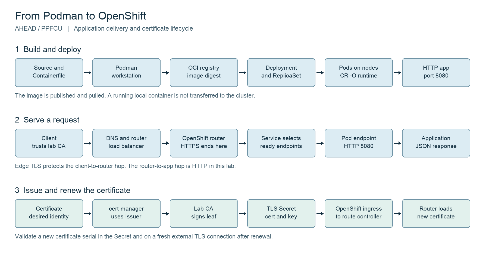

# From Podman to OpenShift

AHEAD and PPFCU • Two-hour instructor-led lab • Prepared 14 October 2026

Build one small HTTP application, publish its container image, deploy it to OpenShift, and connect it to platform routing and certificate lifecycle management. Finish with operational checks, a certificate renewal, and an application rollback. The HTTP server is a teaching application with no customer data or external dependencies.

## Lab assumptions and boundaries

- Audience: engineers new to containers and Kubernetes. No previous container or Kubernetes knowledge is required. The instructor guides terminal use and explains each object before applying it.
- Target platform: OpenShift Container Platform 4.22, as confirmed for this class. Instructor must record the exact 4.22 patch level and installed cert-manager release during rehearsal. The lab environment and cert-manager installation status remain to be confirmed.
- Platform owner installs and validates the supported cert-manager Operator before class. Do not install another cert-manager alongside an existing installation.
- Use isolated training namespaces and an approved OCI registry. Each learner needs a unique namespace and image repository. All commands run from the extracted `lab` directory in a Bash-compatible terminal.
- Default certificate provider: a disposable, namespaced lab CA. Clients explicitly trust its public certificate using `curl --cacert`. No public ACME account, DNS API key, or public ingress is required.
- The primary path uses an explicit Certificate and a Kubernetes Ingress. OpenShift generates and reconciles the Route. There is no ingress-shim annotation because the Certificate already exists. Do not edit the generated Route to implement a persistent change.
- HTTPS ends at the OpenShift router. The router sends HTTP to the application on port 8080. This lab does not implement end-to-end encryption, mutual TLS, user authentication, a database, or a production HTTP server.
- The app is stateless. A container's writable layer and emptyDir do not provide durable storage. Service traffic is sent to ready pod endpoints; packets do not necessarily traverse a separate Service process.

## Agenda

| Elapsed time | Minutes | Activity | Checkpoint |
|---|---:|---|---|
| 00–15 | 15 | Container and Kubernetes foundations | Explain image, container, Pod and project |
| 15–35 | 20 | Guided Podman build and local HTTP test | See the app response and identify its version |
| 35–45 | 10 | Guided image publishing | Understand registry, tag and digest |
| 45–65 | 20 | Guided OpenShift deployment | Two ready pods and an internal HTTP response |
| 65–70 | 5 | Short break and catch-up | Instructor confirms deployment checkpoint |
| 70–90 | 20 | Guided HTTPS and cert-manager integration | Trusted HTTPS response from router |
| 90–105 | 15 | Guided readiness test; instructor configuration and scaling demo | Explain traffic removal and recovery |
| 105–115 | 10 | Instructor renewal and prebuilt v2 rollout/rollback demo | Observe new served serial and restored v1 |
| 115–120 | 5 | Review and cleanup instructions | Explain request and certificate paths |
| Total | 120 | | |

## Start here for first time learners

You do not need to write the application or YAML from scratch. The lab files are supplied so we can focus on what each platform component does. Work in pairs if terminal use is unfamiliar. One person enters commands; the other checks the result. Swap roles at the deployment checkpoint.

| Term | Meaning in this class |
|---|---|
| Image | A packaged application and its runtime dependencies; it is stored, built and published |
| Container | A running instance of an image |
| Pod | The Kubernetes execution unit; this lab runs one app container per Pod |
| Kubernetes | The system that keeps the requested application state running across cluster nodes |
| OpenShift | The platform around Kubernetes that adds integrated application and operations capabilities |
| Project or namespace | Your assigned, named scope for resources; this lab uses the project namespace in every command |
| Deployment | The desired application image, replica count and update behavior |
| Service | A stable way to reach selected, ready application pods |
| Route | OpenShift configuration that exposes a Service at an external hostname |
| Ingress | Kubernetes HTTP routing intent; OpenShift generates a Route from it in this lab |
| Certificate authority or CA | The signer that clients trust to validate a server certificate |
| cert-manager | The controller that requests and renews certificates |

### Reading the commands

- Open a terminal and change to the extracted `lab` folder before starting. Confirm with `pwd` and `ls`: you should see `Containerfile`, `app`, `manifests` and `scripts`.
- A line beginning `export` sets a variable in the current terminal. `$LAB_NS` means “use the namespace value you assigned.” Keep the same terminal open throughout the lab.
- Replace sample environment values only with the instructor-assigned values. Do not type angle-bracket placeholders literally. An example domain is not a working lab hostname.
- A backslash at the end of a command continues it on the next line. Copy the complete block. Lines beginning `#` are explanations.
- `oc` talks to OpenShift. `-n "$LAB_NS"` selects your namespace. `get` reads a summary, `describe` explains status/events, and `apply -f` sends the desired state in a file.
- YAML is indented configuration. A `kind` names the object type; `metadata.name` names the object; `spec` states the desired behavior. Inspect the supplied files before applying them.
- Run one exercise at a time. Compare with its expected result before proceeding. If it fails, stop that exercise and ask the instructor to use the troubleshooting table.

### What participants do and what the instructor demonstrates

Complete exercises 1–6 with the instructor. In exercise 7, participants do the readiness failure/recovery; the instructor demonstrates configuration and scaling. Exercises 8–9 are instructor demonstrations during this two-hour introductory class. Participants can repeat them afterward using the full commands below. The instructor uses prebuilt v1/v2 image digests to keep the demonstration within ten minutes. Optional network policy and production extensions are follow-on material.

Before class, the instructor pre-stages a separate demonstration namespace with a working HTTPS endpoint and known v1/v2 digests. Rehearse the ten-minute sequence there. Participants keep their own healthy endpoint for the final review; they are not required to complete an image rebuild during the demonstration.

## Architecture



Build and delivery: source + Containerfile → Podman → OCI registry → image digest → Deployment → ReplicaSet → Pods running under CRI-O. Podman runs on the workstation; OpenShift does not move the locally running container into the cluster.

Request: client → DNS → router load balancer → OpenShift Ingress Controller/router [HTTPS terminates here] → Service-selected ready pod endpoint [HTTP 8080] → application.

Certificate lifecycle: Certificate → cert-manager → namespaced Issuer → CA → TLS Secret → OpenShift ingress-to-route reconciliation → generated Route → router certificate configuration. Renewal changes the Secret; validate the certificate actually served to the client.

## Instructor setup before class

1. Record the cluster release, cert-manager Operator release, workstation architecture, node architecture, registry hostname, apps domain, and training window. Confirm the support matrix for the chosen releases. Assign unique learner IDs such as `dev-user01`.
2. Platform owner: prepare a healthy disposable OpenShift lab with working ingress DNS and reachable HTTPS. Install the supported cert-manager Operator through the cluster's approved Operator lifecycle workflow. Confirm the controller, webhook, and CA injector are healthy. A healthy installed Operator alone does not prove an Issuer is ready.
3. Platform owner: create one namespace per learner, for example `podman-lab-dev-user01`, and grant that learner the approved namespace role. Verify permission to manage Deployments, Services, ConfigMaps, ServiceAccounts, Ingresses, Certificates, Issuers and Secrets, read Routes and EndpointSlices, and use pod exec/logs/port-forward. Learners do not need cluster-admin, a ClusterIssuer, `anyuid`, or privileged containers.
4. Platform owner: check namespace quota accommodates three pods during rollout and three during the scaling demo, plus ordinary controller resources. The application requests 50m CPU and 64Mi memory per pod and limits each pod to 250m and 128Mi. Allow at least four application pod slots and 1 CPU / 512Mi limit headroom for the exercises; cluster components need separate capacity.
5. Registry owner: provide each learner with push access to a unique repository and read access for the cluster. Verify node-to-registry connectivity, registry trust, and the correct pull credential. Use a trusted registry certificate. Do not disable TLS verification to work around missing trust.
6. Instructor: pre-pull the UBI base image, rehearse the exact build architecture, and pre-stage v1 and v2 images by digest as a fallback. Confirm any proxy, mirrored registry, ImagePolicy, image signature, or scanning requirement. Replace the Containerfile base reference with an approved pinned digest after rehearsal; the included `latest` is convenient for training but mutable.
7. Instructor: test the complete Ingress → generated Route path and Secret renewal propagation on the real cluster. Verify an HTTP request redirects to HTTPS and that clients see the expected leaf certificate. If ingress classes or router sharding are used, add the class/selection configuration approved by the platform owner before class.
8. Instructor: verify workstations have Podman with a running Linux machine where needed, an `oc` client suitable for the server, Python 3, curl, OpenSSL, and optional `cmctl`. Use the approved login method; do not distribute bearer tokens in course material.
9. Instructor: run the course once with a learner account. Save safe sample outputs. A failed prerequisite is a blocker for the affected exercise. Resolve it before the training window.

Useful administrator checks (run by the platform owner, not every student):

```bash
oc get clusterversion
oc get clusteroperators ingress authentication
oc get csv -A
oc get crd certificates.cert-manager.io issuers.cert-manager.io
oc get pods -n cert-manager
oc get ingressclass
oc get ingresses.config.openshift.io cluster -o jsonpath='{.spec.domain}{"\n"}'
```

Discover the actual cert-manager namespace if it differs. Inspect unhealthy Operator events and deployments rather than assuming the example namespace applies.

## 1 Set your environment

Run from `lab` in the same terminal for every exercise. Replace all sample values with instructor-assigned values before running. These exports do not contain credentials.

```bash
export LAB_NS=podman-lab-dev-user01
export REGISTRY=quay.io
export IMAGE_REPO="$REGISTRY/your-training-org/http-lab-dev-user01"
export APPS_DOMAIN=apps.training.example.com
export APP_HOST="http-lab-$LAB_NS.$APPS_DOMAIN"
# Match the OpenShift nodes. Use linux/arm64 only for arm64 nodes.
export TARGET_PLATFORM=linux/amd64
oc login https://api.training.example.com:6443
oc project "$LAB_NS"
oc whoami
oc version
podman info
oc auth can-i create deployments.apps -n "$LAB_NS"
oc auth can-i create certificates.cert-manager.io -n "$LAB_NS"
oc auth can-i create issuers.cert-manager.io -n "$LAB_NS"
```

Expected: correct user and namespace, a healthy Podman connection, and `yes` for these permission checks. The instructor also checks all permissions listed above. On macOS or Windows, initialize/start the approved Podman machine before class if it is not already running. Do not attempt a cluster deployment until the namespace and registry values are assigned.

## 2 Build and test locally

The image contains Python and the app. It listens on an unprivileged port and only needs write access to `/tmp` for the readiness demonstration. Application files are readable by an arbitrary UID. OpenShift chooses the runtime UID; do not set a fixed `runAsUser` in the Deployment.

```bash
podman build --platform "$TARGET_PLATFORM" --build-arg APP_VERSION=v1 \
  -t localhost/http-lab:v1 -f Containerfile .
podman run -d --name http-lab-local --user 1001230000:0 \
  --read-only --tmpfs /tmp:rw,size=16m --cap-drop=ALL \
  --security-opt=no-new-privileges -p 127.0.0.1:8080:8080 \
  localhost/http-lab:v1
curl --fail http://127.0.0.1:8080/
curl --fail http://127.0.0.1:8080/healthz
curl --fail http://127.0.0.1:8080/readyz
podman logs http-lab-local
podman rm -f http-lab-local
```

Expected: HTTP 200 JSON, version `v1`, and UID `1001230000`. The final command removes only the local training container. Building/running amd64 on an arm64 workstation needs configured emulation; if unavailable, use an instructor-provided amd64 builder or the staged image. The target architecture must match the cluster.

## 3 Publish a registry image and capture its digest

Login is interactive. Use the credential process approved for the lab.

```bash
podman login "$REGISTRY"
podman tag localhost/http-lab:v1 "$IMAGE_REPO:v1"
podman push --digestfile v1.digest "$IMAGE_REPO:v1"
export IMAGE_V1="$IMAGE_REPO@$(cat v1.digest)"
printf '%s\n' "$IMAGE_V1"
```

Expected: `registry/repository@sha256:...`. A tag is a movable label. The digest identifies the pushed artifact used in this lab. Do not rebuild and overwrite the same production tag as a deployment strategy.

For a private repository, use the separate, instructor-provided registry auth file containing read-only credentials. Do not use a full personal auth file if it contains credentials for other registries. Do not include this file in the class ZIP or source control.

```bash
oc create secret generic registry-pull -n "$LAB_NS" \
  --type=kubernetes.io/dockerconfigjson \
  --from-file=.dockerconfigjson=/path/to/training-registry-auth.json
```

Skip this Secret for an intentionally public training repository. Creating a pull Secret does not grant push permissions and does not configure node-level trust for a private CA.

## 4 Deploy the application

Render the two placeholders locally, then create the desired state in your assigned namespace. Rendering makes no cluster changes.

```bash
python3 scripts/render.py
oc apply -n "$LAB_NS" -f manifests/serviceaccount.yaml
# Private registry only; link to the ServiceAccount used by this Deployment.
oc secrets link http-lab registry-pull --for=pull -n "$LAB_NS"
oc apply -n "$LAB_NS" -f rendered/app.yaml
oc rollout status deployment/http-lab -n "$LAB_NS" --timeout=180s
oc get deployment,replicaset,pods,service -n "$LAB_NS"
oc get endpointslices -n "$LAB_NS" \
  -l kubernetes.io/service-name=http-lab
oc logs deployment/http-lab -c http -n "$LAB_NS" --tail=15
```

Skip `oc secrets link` for a public repository. The ServiceAccount and its pull credential link are created before the Deployment so new pods can authenticate on their first pull.

Expected: two ready pods; Service port 80 maps to the named container port `http` on 8080. A Deployment manages ReplicaSets, which maintain Pods. The node's CRI-O runtime pulls and starts the image.

Inspect security without printing Secret data:

```bash
export POD=$(oc get pods -n "$LAB_NS" -l app=http-lab \
  -o jsonpath='{.items[0].metadata.name}')
oc exec -n "$LAB_NS" "$POD" -- id
oc get pod -n "$LAB_NS" "$POD" \
  -o jsonpath='{.metadata.annotations.openshift\.io/scc}{"\n"}'
```

Expected: nonzero UID; admission uses an approved restricted Security Context Constraint (SCC). Record the actual admitted SCC; available policies and selection can differ between new and upgraded clusters. OpenShift 4.22 documents both `restricted-v2` and `restricted-v3`; do not require a single SCC name as the success condition. No application API token is mounted.

In a second terminal, run `oc port-forward -n <your-namespace> service/http-lab 8080:80`. In the original terminal, run `curl --fail http://127.0.0.1:8080/`. Stop the port-forward with Ctrl+C. This checks app response via API port-forward, which bypasses the external router and is not a network-policy or HTTPS test.

## 5 Create a disposable certificate authority

Each learner creates a separate root in their training namespace. This gives a repeatable issuance flow without a public CA. The root private key stays in the cluster Secret. Export only the public certificate.

```bash
oc apply -n "$LAB_NS" -f manifests/bootstrap-ca.yaml
oc wait -n "$LAB_NS" --for=condition=Ready \
  certificate/lab-root --timeout=120s
oc apply -n "$LAB_NS" -f manifests/issuer.yaml
oc wait -n "$LAB_NS" --for=condition=Ready issuer/lab-ca --timeout=120s
oc get secret lab-root-ca -n "$LAB_NS" \
  -o jsonpath='{.data.tls\.crt}' | openssl base64 -d -A > lab-root.pem
openssl x509 -in lab-root.pem -noout -subject -enddate
```

Expected: root Certificate and CA Issuer are Ready. `lab-root.pem` contains only a public certificate. Keep this root scoped to the lab. Do not install it as an organization-wide trusted root. The CA Issuer does not provide a complete production public key infrastructure or automatically manage root trust rollover.

## 6 Issue the leaf certificate and expose HTTPS

```bash
oc apply -n "$LAB_NS" -f rendered/tls.yaml
oc wait -n "$LAB_NS" --for=condition=Ready \
  certificate/http-lab-tls --timeout=120s
oc get certificate,certificaterequest,issuer,ingress,route -n "$LAB_NS"
oc get secret http-lab-tls -n "$LAB_NS"
oc get route -n "$LAB_NS" \
  -o custom-columns=NAME:.metadata.name,HOST:.spec.host,TLS:.spec.tls.termination
curl --fail --cacert lab-root.pem "https://$APP_HOST/"
curl -sS -o /dev/null -D - "http://$APP_HOST/"
```

Wait briefly for the generated Route to appear and the router to load its certificate, then retry the HTTPS check if necessary. Expected: `Ready=True`, a `kubernetes.io/tls` Secret, an edge Route with your hostname, HTTPS 200 JSON, and an HTTP redirect to the same HTTPS hostname. If the expected redirect is absent, inspect the generated Route's `insecureEdgeTerminationPolicy` and validate the cluster's ingress-to-route behavior with the instructor.

Use hostname verification and trust validation to inspect the live certificate:

```bash
openssl s_client -connect "$APP_HOST:443" -servername "$APP_HOST" \
  -CAfile lab-root.pem -verify_hostname "$APP_HOST" -verify_return_error \
  </dev/null 2>/dev/null | openssl x509 -noout -subject -issuer -serial -dates
```

Explain: the private CA signs a certificate with the application hostname as a DNS Subject Alternative Name. The client must trust that CA. DNS resolution and a certificate do not authorize a user to access an application. A browser will show a trust error unless its trust store is deliberately configured for the lab root; use the supplied curl command for the exercise. Do not replace validation with `curl -k`.

Do not print the full TLS Secret or generated Route YAML during a screen share; Route implementations can contain the private key. Inspect specific metadata/status fields instead.

## 7 Operate the application

Readiness controls traffic eligibility. Liveness restarts a container that fails its health check. Startup probes delay the other probes until startup succeeds. The demo deliberately fails readiness only, leaving the app alive.

```bash
export POD=$(oc get pods -n "$LAB_NS" -l app=http-lab \
  -o jsonpath='{.items[0].metadata.name}')
oc exec -n "$LAB_NS" "$POD" -- touch /tmp/not-ready
oc get pods -n "$LAB_NS" -l app=http-lab
oc get endpointslices -n "$LAB_NS" \
  -l kubernetes.io/service-name=http-lab -o yaml
curl --fail --cacert lab-root.pem "https://$APP_HOST/"
oc exec -n "$LAB_NS" "$POD" -- rm /tmp/not-ready
oc wait -n "$LAB_NS" --for=condition=Ready "pod/$POD" --timeout=60s
```

Allow several seconds before observing readiness. Expected: one pod changes to `0/1`; its endpoint is not ready; the other pod serves requests; the failed pod does not restart because liveness is still healthy. Removing the marker restores readiness. Sticky routing means repeated requests are not proof of balanced traffic.

Update external configuration and scale:

```bash
oc patch configmap http-lab-config -n "$LAB_NS" --type=merge \
  -p '{"data":{"APP_MESSAGE":"Configuration changed without rebuilding"}}'
oc rollout restart deployment/http-lab -n "$LAB_NS"
oc rollout status deployment/http-lab -n "$LAB_NS" --timeout=180s
curl --fail --cacert lab-root.pem "https://$APP_HOST/"
oc scale deployment/http-lab -n "$LAB_NS" --replicas=3
oc rollout status deployment/http-lab -n "$LAB_NS" --timeout=180s
oc get pods -n "$LAB_NS" -l app=http-lab
oc scale deployment/http-lab -n "$LAB_NS" --replicas=2
oc rollout status deployment/http-lab -n "$LAB_NS" --timeout=180s
```

Expected: the new message appears after restart and replica count changes as requested. Environment variables are captured at container startup; changing a ConfigMap does not rewrite a running process's environment. Secrets are for sensitive configuration, but base64 encoding alone does not encrypt them. Platform encryption and RBAC are separate controls.

## 8 Instructor demonstration of certificate renewal

Natural renewal occurs before expiry based on the actual issued lifetime and configured renewal settings. A two-hour class cannot wait for the 24-hour leaf certificate to approach expiry. Force a reissue to exercise the same Secret and router update path. Do not delete the Secret to renew it.

```bash
oc get secret http-lab-tls -n "$LAB_NS" \
  -o jsonpath='{.data.tls\.crt}' | openssl base64 -d -A > leaf-before.pem
openssl x509 -in leaf-before.pem -noout -serial -enddate
oc get certificate http-lab-tls -n "$LAB_NS" \
  -o jsonpath='{.status.revision}{" "}{.status.renewalTime}{"\n"}'
cmctl renew http-lab-tls -n "$LAB_NS"
oc get certificaterequest -n "$LAB_NS"
```

If `cmctl` is not available, change a Certificate field that triggers reissuance:

```bash
oc patch certificate http-lab-tls -n "$LAB_NS" --type=merge \
  -p '{"spec":{"duration":"25h"}}'
```

Use one of these triggers. Poll the public leaf and Certificate revision until the serial changes and the revision increases:

```bash
oc get certificate http-lab-tls -n "$LAB_NS" \
  -o jsonpath='{.status.revision}{" "}{.status.renewalTime}{"\n"}'
oc get secret http-lab-tls -n "$LAB_NS" \
  -o jsonpath='{.data.tls\.crt}' | openssl base64 -d -A > leaf-after.pem
openssl x509 -in leaf-after.pem -noout -serial -enddate
openssl s_client -connect "$APP_HOST:443" -servername "$APP_HOST" \
  -CAfile lab-root.pem -verify_hostname "$APP_HOST" -verify_return_error \
  </dev/null 2>/dev/null | openssl x509 -noout -serial -enddate
curl --fail --cacert lab-root.pem "https://$APP_HOST/"
```

Expected: a new CertificateRequest, a higher revision, a new Secret leaf serial, and the same new serial on a fresh external TLS connection after reconciliation. `Ready=True` may remain true while a previously issued certificate exists; `oc wait Ready` alone does not prove that renewal completed. If the Secret changes but the served certificate does not, investigate ingress-to-route reconciliation and router configuration. App pods do not need restart because the router holds the edge TLS certificate. On a router fleet, validate all serving instances as part of production acceptance.

## 9 Instructor demonstration of v2 and rollback

The new image changes the baked-in version. Configuration remains external.

```bash
podman build --platform "$TARGET_PLATFORM" --build-arg APP_VERSION=v2 \
  -t "$IMAGE_REPO:v2" -f Containerfile .
podman push --digestfile v2.digest "$IMAGE_REPO:v2"
export IMAGE_V2="$IMAGE_REPO@$(cat v2.digest)"
oc set image deployment/http-lab -n "$LAB_NS" http="$IMAGE_V2"
oc rollout status deployment/http-lab -n "$LAB_NS" --timeout=180s
curl --fail --cacert lab-root.pem "https://$APP_HOST/"
oc rollout history deployment/http-lab -n "$LAB_NS"
oc rollout undo deployment/http-lab -n "$LAB_NS"
oc rollout status deployment/http-lab -n "$LAB_NS" --timeout=180s
curl --fail --cacert lab-root.pem "https://$APP_HOST/"
```

Expected: v2 after rollout, v1 after undo, and the updated ConfigMap message remains. No intervening Deployment change should occur between the v2 rollout and undo. Rollout undo restores a prior pod template, not ConfigMap contents, Secret history, database schema, or external systems. Mutable shared configuration can make a historical revision behave differently. In GitOps-managed environments, revert the source of truth through the approved workflow or reconciliation can overwrite manual changes.

## Optional network isolation demonstration

This is follow-on material outside the two-hour introductory class. Rehearse the cluster's ingress topology before demonstrating it.

```bash
oc apply -n "$LAB_NS" -f manifests/networkpolicy-optional.yaml
curl --fail --cacert lab-root.pem "https://$APP_HOST/"
# Restore the training namespace to its previous policy state.
oc delete -n "$LAB_NS" -f manifests/networkpolicy-optional.yaml
```

This policy permits application ingress from router namespaces labeled `network.openshift.io/policy-group=ingress` and from pods in the same namespace, on TCP 8080 only. It does not isolate other pods or restrict egress. Host-network routers, other CNI behavior, and custom ingress modes can require different controls; the platform owner must validate the policy on this cluster. Demonstrate a denied request from a second isolated namespace only if that namespace and a diagnostic image were prepared beforehand. A successful router request proves the allowed path, not that all other paths are denied.

## Troubleshooting by symptom

| Observation | Meaning to check | First evidence | Owner or corrective action |
|---|---|---|---|
| Podman cannot connect | Workstation Linux backend unavailable | `podman info` | Learner/instructor starts approved machine |
| Exec format error | Image and node CPU architecture mismatch | Pod events; assigned target platform | Rebuild for correct architecture |
| ImagePullBackOff | Wrong image, missing auth, trust or network | `oc describe pod`; image reference; SA pull Secret names | Learner fixes reference/auth; platform fixes registry trust/connectivity |
| Pending | Quota, resources, scheduling or policy | Pod events; namespace quota | Platform owner resolves capacity/policy |
| CrashLoopBackOff | Application startup or liveness failure | Logs and `oc logs <pod> --previous` | App owner corrects startup or probe |
| 503 from router | No ready endpoints, wrong port/selector or denied network | Pod readiness; EndpointSlices; Service ports | Learner checks labels/probes; platform checks policy |
| No generated Route | Ingress class/controller or reconciliation | Ingress events and selected ingress configuration | Platform owner checks controller |
| Certificate not Ready | Issuer, webhook, signing or policy failure | `oc describe certificate`; `oc describe issuer`; CertificateRequest | Learner checks refs; platform/PKI owner checks controller and CA |
| Certificate trusted by no client | Private root is absent from client trust | `curl --cacert lab-root.pem` and DNS SAN | Use scoped lab trust; PKI owner handles enterprise trust |
| Old served serial after renewal | Secret changed but serving layer did not update | Compare public Secret leaf with live TLS serial | Platform owner checks route/router reconciliation |

Use `oc get events -n "$LAB_NS" --sort-by=.metadata.creationTimestamp` and `oc describe deployment http-lab -n "$LAB_NS"` to build an evidence trail. Do not dump full TLS Secrets, kubeconfigs, tokens, or private Route key fields into tickets.

## Platform scope and production follow-on work

| Integration | Covered in the class | Production decision or extension | Typical owner |
|---|---|---|---|
| Identity and access | Named namespace; service account; no API token | IdP integration, least-privilege RBAC, access reviews, application authorization | Platform/security/app |
| Image supply chain | Podman, registry auth, immutable image digest | Pinned base, scanning, SBOM, signing, promotion and retention | App/platform/security |
| Workload security | Arbitrary UID, restricted admission, read-only root, dropped caps | Policy enforcement, runtime monitoring, exceptions review | Platform/security |
| Networking | Service, ready endpoints, DNS, generated Route | NetworkPolicy ingress/egress, firewall, load balancing, DNS ownership | Platform/network |
| Certificates | Lab CA, Issuer, Certificate, TLS Secret, renewal proof | Approved enterprise issuer, CA rollover, trust distribution, expiry alerting, backup | PKI/platform |
| Encryption | Edge HTTPS | Re-encrypt with backend server certificate and trusted destination CA; passthrough if app terminates TLS; mesh mTLS if required | App/platform/security |
| Configuration | ConfigMap with restart semantics; Secret concept | External secret provider, secret rotation, reload behavior | App/security |
| Reliability | Startup/readiness/liveness; 2 replicas; rollout | Topology spread, disruption budget, HPA and metrics, capacity, SLOs | App/platform |
| Observability | Stdout logs, events, readiness, cert status | User workload monitoring, ServiceMonitor plus real app metrics, centralized logs, alerts, traces | App/operations |
| Storage and recovery | Stateless; emptyDir explained | PVC/storage class, backup and restore exercises, disaster recovery | App/storage/platform |
| Delivery and governance | Manual deploy, digest promotion, undo | Pipelines, GitOps, approvals, audit, declarative rollback | App/platform |

Kubernetes does not automatically turn an app's stdout into centralized retained logs, nor does this app expose Prometheus metrics. Those need separate platform services and configuration. Replicas improve process availability but do not guarantee different nodes or uninterrupted service during every failure.

For enterprise certificates, replace `lab-ca` with the approved namespaced Issuer, or change `issuerRef.kind` to `ClusterIssuer` and its name to the platform-provided issuer. Skip the disposable root bootstrap. For a ClusterIssuer, the supporting CA credential location is determined by the controller's cluster-resource namespace, not by the application namespace. The platform/PKI owner manages that scope. Validate issuer policy and duration constraints.

ACME is a follow-on option: HTTP-01 requires the CA to reach the challenge endpoint over HTTP; DNS-01 requires controlled DNS changes and can issue wildcard certificates. Public authorities will not validate an internal-only name through an unreachable HTTP endpoint. Use a staging issuer during rehearsal. Enterprise Vault/CA integrations need their own approved auth, policies, and trust setup.

The OpenShift service CA can issue internal Service serving certificates. It is a separate trust and lifecycle mechanism from the application hostname certificate in this lab. Service mesh workload identity/mTLS is another distinct integration and is not required to publish this HTTP app.

OpenShift 4.22 documents a Route `externalCertificate` Secret reference directly. Confirm the required router Secret-read RBAC and cluster configuration before selecting that design. This lab deliberately uses the documented Ingress integration to make ownership and reconciliation visible. Copying a leaf certificate into a manually created Route once does not establish automatic renewal propagation.

## Completion check and cleanup

Participants complete items 1–4 in class and explain the instructor evidence for items 5–6:

1. Local HTTP response under a nonroot UID and a published image digest.
2. Two ready OpenShift pods and a Service with ready endpoints.
3. HTTPS response with CA and hostname validation enabled.
4. Readiness failure on one pod with continued service and recovery.
5. Observe a new certificate serial in the Secret and the live external TLS response after the instructor forces reissue.
6. Observe the instructor perform a v2 rollout and v1 rollback with the external configuration preserved.

Knowledge check: Which component runs the container in OpenShift? Where does HTTPS terminate? What changes on certificate renewal? Why does a ConfigMap env change need a restart? Does rollback restore a database? Expected answers: CRI-O on the node; the router; CertificateRequest/Secret and then the serving configuration; process environment is set at startup; no.

After the instructor confirms evidence has been captured, remove only this lab's resources. Do not delete a shared namespace or cluster Operators.

```bash
oc delete -n "$LAB_NS" -f rendered/tls.yaml --ignore-not-found
oc delete -n "$LAB_NS" -f manifests/issuer.yaml --ignore-not-found
oc delete -n "$LAB_NS" -f manifests/bootstrap-ca.yaml --ignore-not-found
oc delete secret http-lab-tls lab-root-ca registry-pull \
  -n "$LAB_NS" --ignore-not-found
oc delete -n "$LAB_NS" -f rendered/app.yaml --ignore-not-found
oc delete -n "$LAB_NS" -f manifests/serviceaccount.yaml --ignore-not-found
oc delete -n "$LAB_NS" -f manifests/networkpolicy-optional.yaml --ignore-not-found
rm -f lab-root.pem leaf-before.pem leaf-after.pem v1.digest v2.digest
```

Instructor/platform owner removes a dedicated namespace only through the agreed training cleanup process. Registry owner removes the training images if retention policy requires it. Root/leaf Secrets may remain after Certificate deletion depending on controller ownership settings; the explicit Secret cleanup handles this.

## References and validation status

Official sources consulted 14 October 2026:

- [Red Hat OpenShift 4.22 routes and Ingress integration](https://docs.redhat.com/en/documentation/openshift_container_platform/4.22/html/ingress_and_load_balancing/routes)
- [Red Hat cert-manager Operator](https://docs.redhat.com/en/documentation/openshift_container_platform/4.22/html/security_and_compliance/cert-manager-operator-for-red-hat-openshift)
- [Red Hat 4.22 security context constraints](https://docs.redhat.com/en/documentation/openshift_container_platform/4.22/html/authentication_and_authorization/managing-pod-security-policies)
- [Red Hat image creation and arbitrary UID guidance](https://docs.redhat.com/en/documentation/openshift_container_platform/4.22/html/images/creating-images)
- [cert-manager Certificate lifecycle](https://cert-manager.io/docs/usage/certificate/)
- [cert-manager CA Issuer](https://cert-manager.io/docs/configuration/ca/)
- [cert-manager Ingress integration](https://cert-manager.io/docs/usage/ingress/)
- [Podman build](https://docs.podman.io/en/latest/markdown/podman-build.1.html)

These files are prepared course materials. Check `VALIDATION.txt` for the exact local checks performed. Cluster deployment, registry push, image build, and live TLS renewal require rehearsal in the target lab and must not be represented as already verified.
